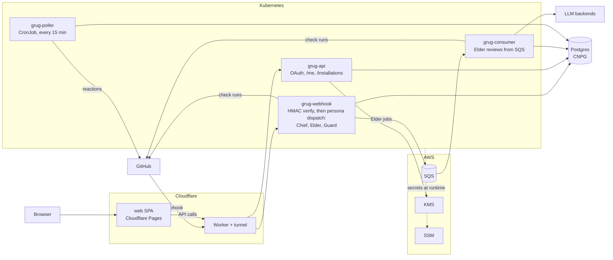

<p align="center">
  
</p>

<h1 align="center">Grug</h1>

<p align="center">
  <strong>Grug see bug. Grug crush bug. Grug guard code.</strong>
</p>

<p align="center">
  <a href="https://github.com/apps/grug-tribe/installations/new"></a>
  <a href="https://grug.lol"></a>
  <a href="LICENSE"></a>
</p>

Grug is a GitHub App that reviews pull requests. On every PR it checks that
the description says why, what done looks like and how big the change is,
reviews the code with an LLM, and scans it for security problems. It answers
with check runs and inline review comments, not a pile of chat comments.
You ship. Grug guard.

## What you see on a PR

Each part of the review is a persona with its own check run, named
`Grug - <Persona>`. Three of them can hold a merge:

| Check | What it looks at | When it fails |
|---|---|---|
| `Grug - Chief` | The PR body, read as a Hunt Plan (below). Runs at once, no LLM. | A required section is missing or empty, the PR is `Size: XL`, or a linked ticket has no epic. |
| `Grug - Elder` | The code. An LLM review with whole-file and cross-file context, posted as inline findings plus a findings table in the check summary. | It finds a real problem. A degraded review (model outage, unreadable answer) ends `neutral`, never a block. |
| `Grug - Guard` | Security: SAST, secrets on added lines, dependency CVEs, and Terraform, Kubernetes and Dockerfile misconfigs. An LLM judge drops the noise first. | Advisory by default: findings post as `neutral` until the repo turns on Guard blocking. |

Also on by default:

- **Teller** (`Grug - Teller`) writes a walkthrough of the change into its
  check run and the PR's board comment.
- **Haunt** comments once when a PR closes over an unresolved critical
  finding.

Opt-in per repo: **Smasher** (mutation testing), **Totem** (release notes
and semver after merge) and **Drum** (scheduled project-health nudges).

### Talking to Grug

Comment on the PR with a slash command. No at-sign: the bot reads the
command, and the at-sign handle belongs to someone else.

| Command | What it does |
|---|---|
| `/grug improve` | Elder reviews the PR again and re-posts its findings. |
| `/grug recheck` | Chief re-runs the Hunt Plan checks. |
| `/grug ask <question>` | Answers a question about the diff as a reply. |
| `/grug fix` | Applies every unresolved suggested fix as one commit. |
| `/grug review` | One Elder review now, even while Elder is paused. |
| `/grug resume` | Lifts the auto-pause (five pushes in ten minutes) and reviews what changed. |

The full list, including `test-gaps`, `learnings` and `accept-removal`, is
at the top of
[`services/webhook/grug_commands.py`](services/webhook/grug_commands.py).

### What Chief wants in the PR body

The repo's [PR template](.github/pull_request_template.md) has every
section Chief reads.

| Check | Passes when | Blocks? |
|---|---|---|
| `why` | `## Why` (or `## Summary`) has at least 5 words | yes |
| `acceptance` | `## Acceptance criteria` (or `## Test plan`) has 3+ non-empty bullets | yes |
| `estimate` | The body says `Size: XS`, `S`, `M` or `L` (XL must be split) | yes |
| `scope-fence` | `## Out of scope` is not empty | yes |
| `linked-issue-completeness` | Every ticket closed by a closing keyword has its boxes ticked | yes |
| `linked-issue-epic` | Every ticket the body names is an epic or belongs to one | yes |
| `issue-link` | The body links a ticket, e.g. `Refs #N` or `Part of #N` | advisory |
| `loom-footer` | A PR naming a Loom ticket carries the Loom audit footer | advisory |
| `in-scope` | Every changed file traces to the linked ticket's scope | advisory |

Text inside HTML comments does not count, so an unfilled template fails.
Write `Refs #N` rather than a closing keyword: a ticket closes once its
boxes are ticked, not when the PR merges.

A PR body with an agent's marker gets a `neutral` Chief (which still
satisfies a required check) unless a trusted maintainer opened it. The
check title names the rule that applied.

Run the same checks before you open the PR:

```bash
make chief-check REPO=owner/name BODY=pr.md   # a body you are about to post
make chief-check REPO=owner/name PR=123       # an open PR
```

It exits 0 when Chief would pass and 1 when it would hold the PR.

## Install

**Hosted, at [grug.lol](https://grug.lol).**

1. Sign in with GitHub.
2. Install the `grug-tribe` GitHub App on the repos you want reviewed.
3. Turn personas on or off per repo in the dashboard.

The hosted instance is allowlist-gated: open an issue on this repo to ask
for access.

**Self-hosted.** Grug is AGPL-3.0, so you can run your own. You need an AWS
account, a Cloudflare account, a Kubernetes cluster with arm64 nodes, and
your own GitHub App. [`docs/SELF_HOST.md`](docs/SELF_HOST.md) walks through
it, and [`docs/HITL_PREREQUISITES.md`](docs/HITL_PREREQUISITES.md) covers
registering the App.

To make Grug gate merges, add `Grug - Elder` (and `Grug - Chief` if you
want the Hunt Plan enforced) as required status checks on the branch.

## Architecture



| Part | What it does | Code |
|---|---|---|
| web | Landing page and dashboard (React + Vite) on Cloudflare Pages | [`web/`](web/) |
| grug-webhook | Checks GitHub's signature, runs Chief, starts Guard and Teller, and queues Elder | [`services/webhook/`](services/webhook/) |
| grug-consumer | Waits for a PR to settle, then runs Elder reviews, reruns and `/grug ask` | [`services/webhook/consumer.py`](services/webhook/consumer.py) |
| grug-poller | Reads reactions on Grug's comments to learn which findings were right | [`services/webhook/poller_handler.py`](services/webhook/poller_handler.py) |
| grug-api | GitHub sign-in, the dashboard's reads and writes, admin | [`services/api/`](services/api/) |
| Personas | Chief, Elder, Guard and the rest, shared by both services | [`services/_shared/personas/`](services/_shared/personas/) |
| Deploy | Kubernetes manifests, and Pulumi for the AWS side | [`k8s/`](k8s/), [`infra/pulumi/`](infra/pulumi/) |

Postgres holds installs, repo settings, review history and learnings. KMS
encrypts users' OAuth tokens. Pods read the App key and LLM keys from SSM
at runtime. The Datadog integrations are still in the code but have been
off since 2026-10-05; `GRUG_DATADOG_ENABLED=true` turns them back on.

[`docs/NETWORK-TOPOLOGY.md`](docs/NETWORK-TOPOLOGY.md) has the request
flows and trust boundaries.

## Run and test it

You need Python 3.13 and [uv](https://docs.astral.sh/uv/); the web app
also needs Node.

```bash
make test          # webhook, api and scripts tests; no AWS calls
make webhook-test  # or one suite at a time
make api-test
make scripts-test
```

Store tests skip unless `GRUG_TEST_DATABASE_URL` points at a Postgres. CI
gives them one, and also runs:

```bash
make pg-test       # the Postgres store tests
```

The web app:

```bash
cd web
npm install
npm run dev        # http://localhost:5173
npm test
```

Other targets: `make pulumi-preview` (read-only infra diff), `make smoke`
(checks the public endpoints), and `make elder-eval` and
`make sast-benchmark` (score review quality on a committed corpus; these
call real models).

### Check a PR's claims after a deploy

[`scripts/shepherd_verify.py`](scripts/shepherd_verify.py) reads a PR's
`## Acceptance criteria` and checks the bullets that name a `Metric`,
`Log event`, `Endpoint` or `GET` signal:

```bash
python3 scripts/shepherd_verify.py --pr 123 --repo example-org/example-repo \
  --since-epoch "$DEPLOY_FINISHED_UNIX" \
  --query-command /path/to/your-query-adapter \
  --baseline metric=your.known_live.metric
```

- The adapter gets `source signal start_epoch end_epoch criterion` and
  prints one count. For an endpoint it counts only responses that match the
  expected status or body.
- Each source needs a baseline known to emit in the window. A target is
  `missing` only when two checks 30 seconds apart both see the baseline live.
- Exit codes: 0 observed, 1 missing, 2 unverifiable (no baseline, an empty
  baseline, a failed lookup, or no explicit signal in the PR).

## Configure a repo

An optional `.grug.yaml` at the repo root tunes Elder. Grug reads it from
the PR's base commit, so a PR cannot loosen its own review.

| Key | Effect |
|---|---|
| `ignore` | Path globs Elder never reviews |
| `path_instructions` | Extra review instructions for files matching a path |
| `min_inline_severity` | Findings below this level stay in the summary, with no inline comment |
| `skip_prs` | Skip Elder and Teller for PRs matching `authors`, `labels` or `title_patterns` |

```yaml
ignore:
  - vendor/**
  - "*.lock"
path_instructions:
  - path: "k8s/**"
    instructions: Check every container sets resource requests and limits.
min_inline_severity: medium
```

[`docs/REPO_CONFIG.md`](docs/REPO_CONFIG.md) has the details. Which
personas run, and whether Elder and Guard block, is set per repo in the
dashboard.

## Contributing

Issues and PRs are welcome. Grug reviews its own repo, so your PR gets the
same treatment as everyone else's: fill in the Hunt Plan from the
[PR template](.github/pull_request_template.md) (`## Why`,
`## Acceptance criteria`, `## Out of scope`, `Size:`, `Refs #N`), and
`Grug - Elder` must pass on your head commit. Fair is fair.

- Work is tracked in the
  [open epics](https://github.com/quadseven/grug/issues?q=is%3Aopen+is%3Aissue+in%3Atitle+Epic).
- This repo is public: read [`AGENTS.md`](AGENTS.md) before writing code,
  issues or PR text.

## Docs

| Doc | What is in it |
|---|---|
| [`CONTEXT.md`](CONTEXT.md) | Glossary: every term in the code |
| [`docs/RUNBOOK.md`](docs/RUNBOOK.md) | Operations: first deploy, secret rotation, tear-down and rebuild |
| [`docs/SELF_HOST.md`](docs/SELF_HOST.md) | Running your own Grug |
| [`docs/HITL_PREREQUISITES.md`](docs/HITL_PREREQUISITES.md) | Registering the GitHub App |
| [`docs/NETWORK-TOPOLOGY.md`](docs/NETWORK-TOPOLOGY.md) | Request flows, placement, trust boundaries |
| [`docs/REPO_CONFIG.md`](docs/REPO_CONFIG.md) | `.grug.yaml` reference |
| [`docs/adr/`](docs/adr/) | Architecture decision records |

## License

[AGPL-3.0](LICENSE). If you run a modified Grug as a network service,
[`docs/SELF_HOST.md`](docs/SELF_HOST.md) explains what you owe its users.

<p align="center">
  <sub>Grug not lawyer. Grug just guard.</sub>
</p>
